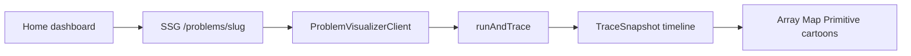

# AlgoTrace Vision150 static visualizer

The workspace at `/Users/maruf.hossain/Works/others/ws/AlgoTrace` is empty. Build the app exactly as specified: no backend, no database, no auth, all problems in code, `output: 'export'` for Firebase Hosting. Do not run `firebase deploy`.



## Scaffold and config

- Initialize in the current directory with `create-next-app` (App Router, TypeScript, Tailwind, ESLint, `src/`, import alias `@/*`), then install `zustand`, `framer-motion`, `lucide-react`, `clsx`, `tailwind-merge`, `@babel/parser`, `@babel/traverse`, `@babel/generator`, `@babel/types`, and the Babel type packages.
- Zustand, `clsx`, and `tailwind-merge` are installed as requested. Playback state stays in the workspace component, matching the provided React state, so those packages are available without an unused store.
- Replace [next.config.ts](next.config.ts) with `output: 'export'`, `trailingSlash: true`, and `images.unoptimized: true`.
- Add [firebase.json](firebase.json) exactly as specified (`public: "out"`, long-cache header for `/_next/static/**`).
- Add [.firebaserc](.firebaserc) so the Firebase CLI targets project `algotrace-ac31a`:

```json
{
  "projects": {
    "default": "algotrace-ac31a"
  }
}
```

- Scripts: `dev`, `build`, `start`, and `deploy` (`next build && firebase deploy --only hosting`). `deploy` uses that default project and does not need `--project`. **Lint script deviation:** Next.js 16 removed `next lint` (confirmed in the v16.2.9 upgrade docs). Use `"lint": "eslint ."` so the script actually runs. `next build` still typechecks.
- Still do not run `firebase deploy` during implementation. The project id is only wired so a later deploy goes to `algotrace-ac31a`.
- Ignore the static `out/` artifact in `.gitignore`.

## App files

Create the spec tree under `src/`:

- [src/types/problem.ts](src/types/problem.ts) — `Difficulty`, `TestCase`, `ProblemEntry`, `TraceSnapshot` as given.
- [src/data/problems.ts](src/data/problems.ts) — Contains Duplicate, Two Sum, and Group Anagrams, including the provided solutions and test cases.
- [src/lib/engine/tracer.ts](src/lib/engine/tracer.ts) — Babel parse, instrument, `new Function` runner, 500-step guard, JSON clone, `changedVars` vs the previous snapshot, `returnValue` on the last step, CJS/ESM interop for `traverse` and `generate`.
- Visualizers and [src/components/workspace/ProblemVisualizerClient.tsx](src/components/workspace/ProblemVisualizerClient.tsx) — test-case pills, line highlight, scrubber, play/pause, 0.5x/1x/2x, ArrowLeft/ArrowRight/Space.
- [src/app/page.tsx](src/app/page.tsx) — client dashboard: hero `N / 150`, search by number/title/category, cards grouped by category.
- [src/app/problems/[slug]/page.tsx](src/app/problems/[slug]/page.tsx) — `generateStaticParams()` from `PROBLEMS`, `await params` (`Promise<{ slug: string }>` in current Next.js).
- [src/app/layout.tsx](src/app/layout.tsx) — the spec names this file but does not include source. Dark `slate-950` shell, metadata title AlgoTrace, compact header linking home. Pages keep their own content chrome.

## Corrections required for a real build

These are bugs in the pasted snippets, not product changes:

- JSX props in the workspace, slug page, and home links were pasted as strings (`problem="{problem}"`, `changed="{...}"`, `href="{...}"`). Pass real expressions or the UI receives literal text and will not typecheck.
- Static export rejects dynamic routes with `dynamicParams: true` (the default) and routes that omit `generateStaticParams`. Export `dynamicParams = false` next to `generateStaticParams`. Unknown slugs 404; every seeded slug is pre-rendered.
- The `Statement` visitor inserts `__record(...)` expression statements, and Babel visits inserted nodes. Without a skip, instrumentation recurses forever. Ignore statements whose callee is already `__record`. Still skip `for`/`while` init declarations, and still record at the start of loop bodies plus after normal statements and before `return`.
- If Babel’s client bundle pulls Node builtins under Turbopack, add the smallest `turbopack.resolveAlias` / webpack fallback for those builtins. Keep `@babel/parser`, `traverse`, `generator`, and `types`. Do not switch libraries unless the build cannot bundle them.
- Use `import type` where the scaffold’s TypeScript config requires it.
- Return banner: compare `JSON.stringify(returnValue)` to `JSON.stringify(expected)`. Match stays the emerald check. A mismatch uses a distinct warning state so the checkmark is only shown when the case passes. Seeded Group Anagrams expectations follow this solution’s insertion order, so those cases pass.
- String primitives (`word`, `sortedKey`) render as a short row of character tiles inside the existing primitive card. Arrays, maps, and the return banner stay as specified. Nested map values (anagram groups) stay as chips inside [src/components/visualizer/MapCartoon.tsx](src/components/visualizer/MapCartoon.tsx).

Tracing runs in `useEffect` on the client, so static prerender does not call `new Function`. The first paint is the empty stage, then the first test case fills the timeline.

## Verification

- `npm run build` completes with no TypeScript errors and writes `out/index.html` plus `out/problems/contains-duplicate/`, `two-sum/`, and `group-anagrams/`.
- `npm run lint` is clean.
- In the browser: search the dashboard, open each problem, switch every test case, step with the buttons and keyboard, and confirm line highlight, array pointer badges, map pop/glow, and a passing return banner. Confirm an execution error path only if a case throws; the seeded cases should not.
