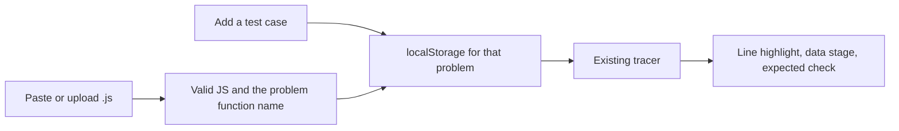

# Practice with your own JavaScript

The purpose is practice. A person puts their solution on the problem page, either by pasting it or by choosing a `.js` file, adds the cases they care about, and watches the run. The last step shows the return value next to the expected value.

## Where it lives

The controls sit on the existing problem page, [src/components/workspace/ProblemVisualizerClient.tsx](src/components/workspace/ProblemVisualizerClient.tsx). There is no separate library page. The built-in solution and its cases stay available, and a control switches back to them.

## What the solution must be

- Pasted text and file text both have to be JavaScript before they are saved. A file must end in `.js`; any other extension is rejected unread. Pasted text has no extension, so `@babel/parser` with `sourceType: 'script'` and no TypeScript plugin is the gate. A syntax error, including a type annotation, is shown and is not saved.
- The saved source is then the code the page runs. [src/lib/engine/tracer.ts](src/lib/engine/tracer.ts) already parses that way and executes with `new Function`, so the pasted solution takes the same path as a fixed problem.
- A declaration of that problem's `functionName`, such as `function twoSum` on the Two Sum page. Without that name the tracer has nothing to call.

## Custom cases

- Fields for a short label, the arguments, and the expected value. Arguments and expected value are JSON, so `[2, 7, 11, 15]` and `9` become the same `args` and `expected` shape the built-in cases use. Invalid JSON is shown and not saved.
- Save those cases with the solution under the problem slug. The person can add more and delete one. Built-in cases stay on the page and are not written over.
- The case buttons list the built-in cases first, then the saved ones. Choosing a case sets `args` and `expected` and runs the active solution. That is the same selection the fixed problems already use.
- The code panel, line highlight, scrubber, play controls, array and map stage, and return banner stay the components already on the problem page. Nothing about playback is a second visualizer. The only swap is the source string and which case list is available.

## How practice works

- Save one solution per problem slug in `localStorage`. Pasting again or uploading again overwrites that problem's solution. Clearing it returns to the built-in solution and hides the custom cases until they are saved again.
- When a saved solution is active, pass its source to `runAndTrace` with the selected case's arguments, whether that case is built in or saved.
- Collect `let`, `const`, `var`, and parameter names from the uploaded function and track those, so the stage follows the names the person wrote. Loop index names found in `for` headers are the pointer badges.
- The existing return banner compares the result with `expected`. A match is the "this is right" signal. A mismatch stays on screen with both values.
- Cap the file around 200 KB, catch a full-storage error, and read storage after mount so the server HTML and the first client render match. The file never leaves the browser.

## Files

- [src/lib/scripts/validate.ts](src/lib/scripts/validate.ts) for the extension, syntax, and function-name checks, plus the tracked-name collection.
- [src/lib/scripts/storage.ts](src/lib/scripts/storage.ts) for load, save, and clear of the solution and its cases by problem slug.
- [src/components/workspace/ProblemVisualizerClient.tsx](src/components/workspace/ProblemVisualizerClient.tsx) for the paste field, the file input, the case form, and the tracer call.
